<div align="center">

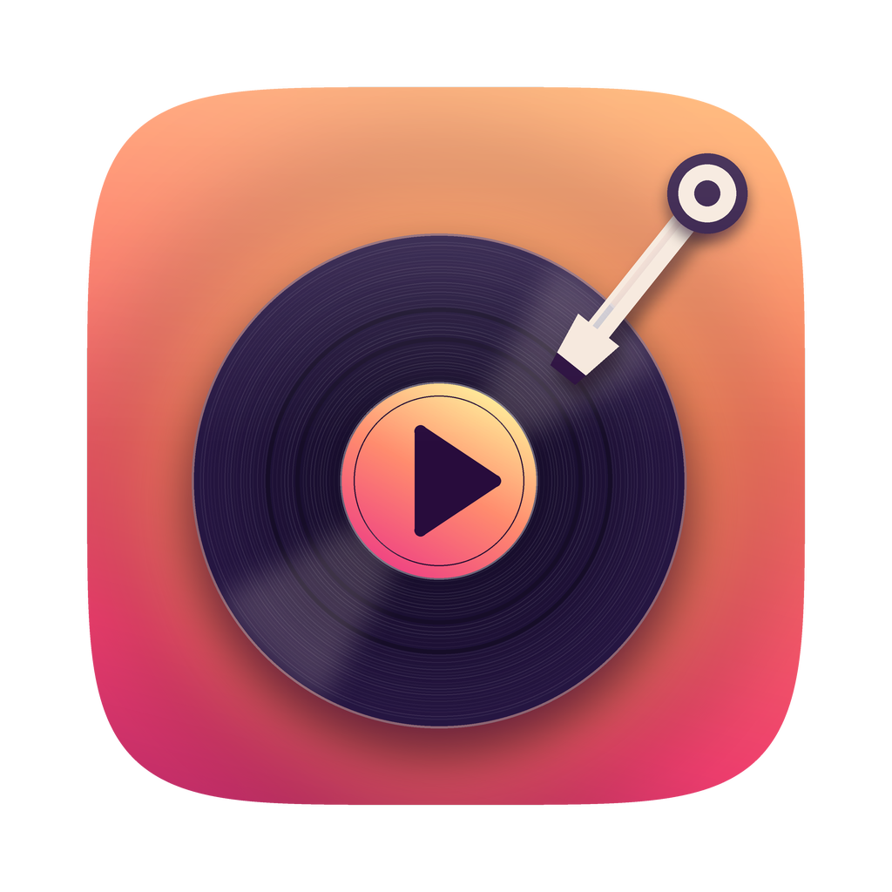

# Sonus

### The music player your Mac deserves.

**Beautiful. Fast. Free. Private.** Your own music library, in a glass-smooth app that fills itself with the colours of whatever is playing.

[](https://github.com/panawel/sonus-player/releases/latest)
[](https://github.com/panawel/sonus-player/releases)
[](LICENSE)


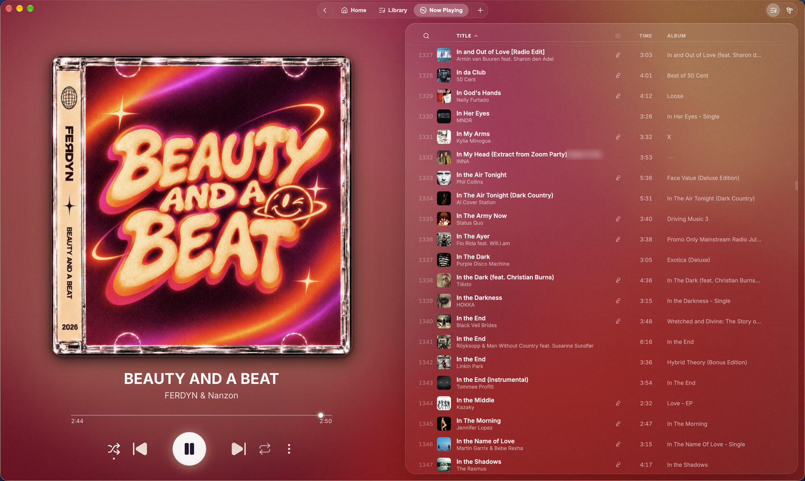

**[⬇ Download Sonus for macOS — free](https://github.com/panawel/sonus-player/releases/latest)**

One download for every Mac, Intel or Apple Silicon · macOS 12 or newer

<sub>**1.10 is the last version for Intel Macs.** Later versions will be for Apple Silicon only.</sub>

</div>

---

## Why you'll love it

- 🎨 **It looks stunning.** Glass everywhere, and a living, slowly flowing background painted from each song's cover. Every song gets its own mood.
- ⚡ **It stays fast.** Smooth with **20,000 songs**. Re-sorting your whole library is instant. Every screenshot here is a real 3,600-song library.
- 🔒 **It's private.** **0** accounts, **0** ads, **0** tracking. Nothing leaves your Mac unless you click a button that says so.
- ✍️ **It fixes your tags for real.** Titles, artists, covers and lyrics are written **into the file itself** (MP3, FLAC and WAV), not into some hidden database. One click finds the right tags and cover online.
- 🛋️ **It knows how to relax.** **Chill mode** turns your song into a living scene: a spinning record, a hammock by the sea, a rainy study room.
- 📐 **It fits anywhere.** Full screen, phone-narrow, a tiny mini player, or a slim strip that sits right next to the Dock.
- 💸 **It's free and open source.** Forever. No trial, no subscription.

Plays **MP3, FLAC, WAV, OGG, M4A and AAC**.

---

## What's new in 1.10

- **Shuffle that really shuffles.** Whatever list you play from (the Library, an artist, an album, a Mix) is what plays. Shuffle plays every song once in a fresh order, and a new order each time you turn it on. Repeat loops that list, and it stops at the end when Repeat is off.
- **Now Playing and Library, side by side, from the top bar.** Switch both on to see the song with your Library beside it; switch one off to go back to the other. The two tabs light up as one when they're together.
- **Search on every artist and album page.** Press `⌘F` or just start typing, the same as in the Library.
- **Hold Play** to jump the Library beside the song to what's playing.
- **Fixes:** a song you left paused no longer starts by itself on slower Macs, no more coloured line around the window or orange rings on buttons, and a calmer background while you scroll.

### New in 1.9

- **Your Library beside the song.** Now Playing can share the window with your Library or the lyrics.
- **A Now Playing tab** in the top bar, which takes you straight back to your song exactly as you left it.
- **Living colour.** The background flows with the colours of the cover, behind every page, and changes the instant you skip.
- **Lyrics you can actually read.** Big, centred lines, and the ones you're reading light up as you scroll.
- **Search, rebuilt.** Just start typing. Words in any order, accents ignored, matches highlighted.
- **Strip mode.** A slim player that docks beside the macOS Dock and stays out of your way.
- **It comes back as you left it.** Reopen Sonus to the same song, paused where you stopped, with your queue, shuffle and repeat.
- **Home** now filters everything by decade with a single row of tags.
- **A new floating player**, tinted with the colours of the song.

---

## Take the tour

### Now Playing, the way it should be

Big artwork, a background that takes the cover's colours, and lyrics that are a pleasure to read. Hebrew and Arabic lyrics show right-to-left, the way they should. Want your Library next to the song? Switch on both Now Playing and Library in the top bar. The lyrics are one tap away too.

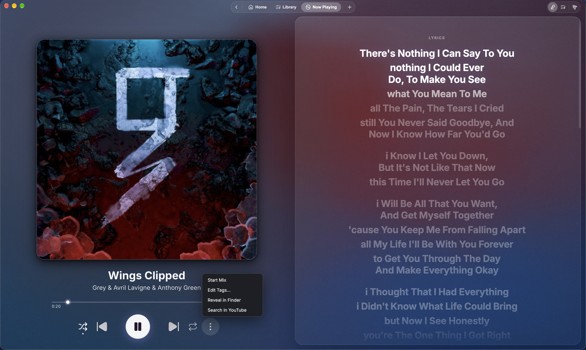

### Home: your music, at a glance

A featured artist, quick picks, your latest releases, and one row of decades that filters the whole page. Everything is a way into your music.

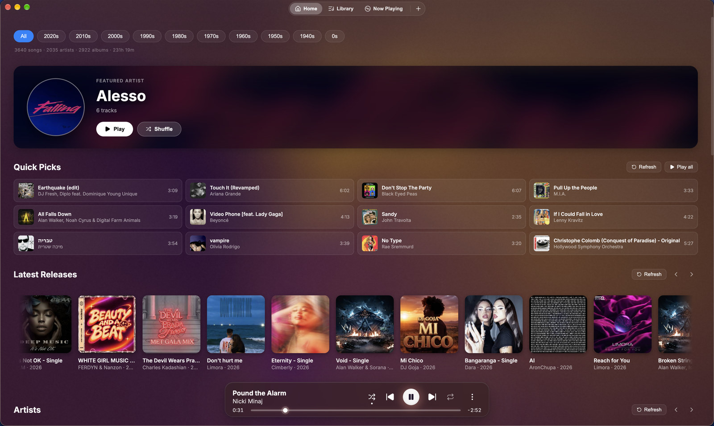

Scroll down and see your library like never before: songs by year, sound quality, how complete your tags are, and which languages you listen to. **Every bar is clickable.** Tap "128 kbps" to find the songs that sound worst, or "missing lyrics" to go fill them in.

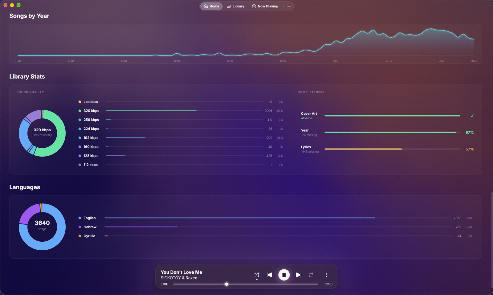

### A library that keeps up with you

Click a column to sort. Start typing to search. Drag to reorder, multi-select with `⇧` and `⌘`. Smooth whether you have 300 songs or 20,000.

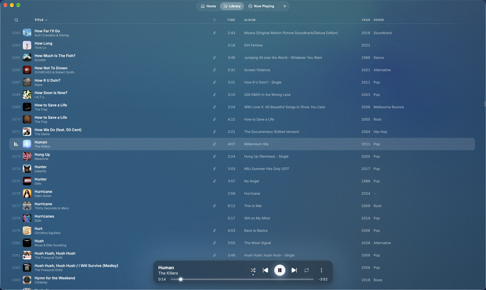

Click any artist, album, year or quality to get its own page, with Play, Shuffle, and a menu for **Play Next**, **Start Mix** (similar songs from your own library), **Edit Tags** and more.

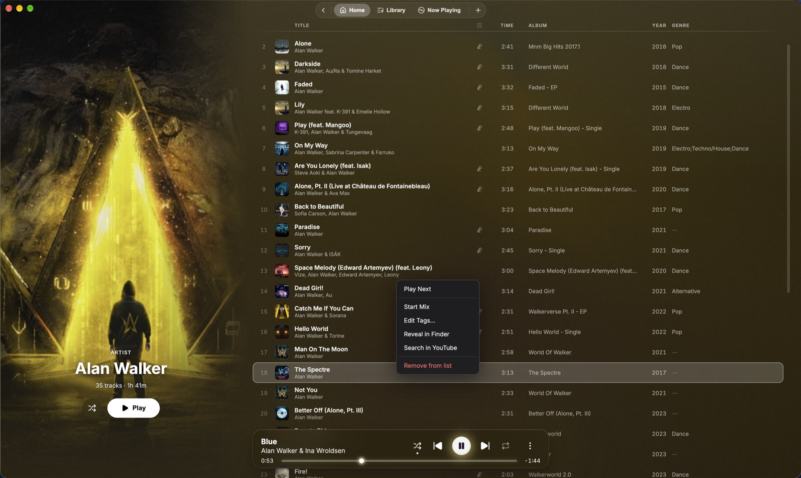

### Chill mode

One click on the palm tree (or `⇧⌘C`) and your song becomes a scene, with its artwork built right in:

- **The turntable.** Your cover is the spinning record.
- **The hammock.** Your cover glows on a phone, swinging gently by the sea while the palms sway and the waves roll in.
- **The study room.** Your cover hangs on the walls of a rainy room, with lightning, steam from the mug, and a girl typing the song's own lyrics on her laptop.

<div align="center">
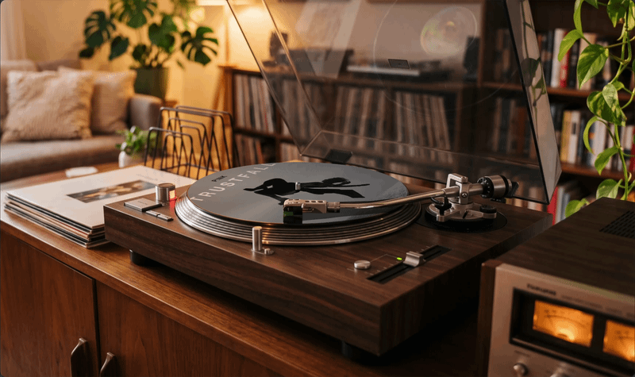
</div>

The controls fade away when you stop moving the mouse. Just the music and the scene.

### One app, every size

Drag the window's edge, or pick a size from the **File** menu. Same library, same controls.

<p align="center">
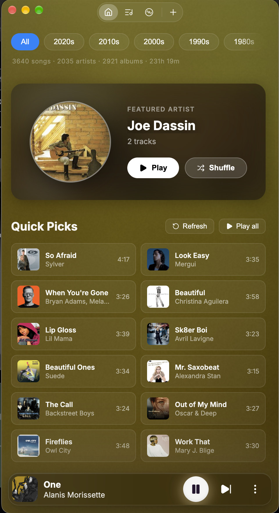
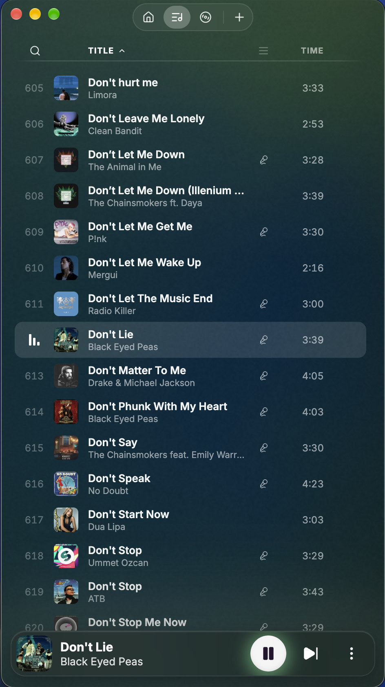
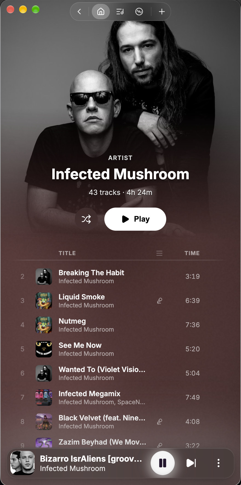
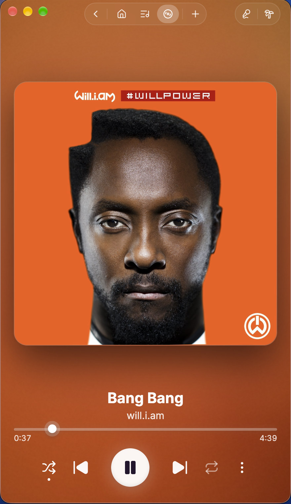
</p>

Make it short and it becomes a **mini player**. Shrink it further and it becomes the **strip**, a slim player that sits right beside your Dock:

<p align="center">
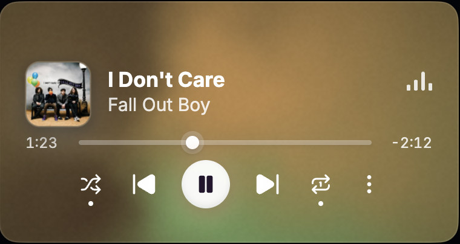
<br><br>
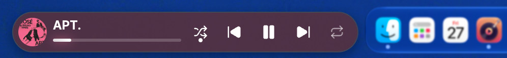
</p>

<details>
<summary><b>All the sizes</b></summary>

| | Size | What you get |
| --- | --- | --- |
| **Filled Screen** `⌃⌘M` | fills the screen | the full layout |
| **Narrow** `⌥⌘2` | 440 × 760 | a phone-style layout with a compact player |
| **Mini** `⌥⌘3` | 380 × 200 | artwork, title, seek bar and controls |
| **Strip** `⌥⌘4` | a slim capsule | cover, title, seek line and controls, beside the Dock. Drag it anywhere; let go near the Dock and it snaps back in. `Esc` or a click on the cover brings the full window back |

</details>

### A tag editor that actually saves

Messy titles? Missing covers? Fix them once and for all. Sonus writes your changes **into the music file itself**, so they follow your songs everywhere, into any other player.

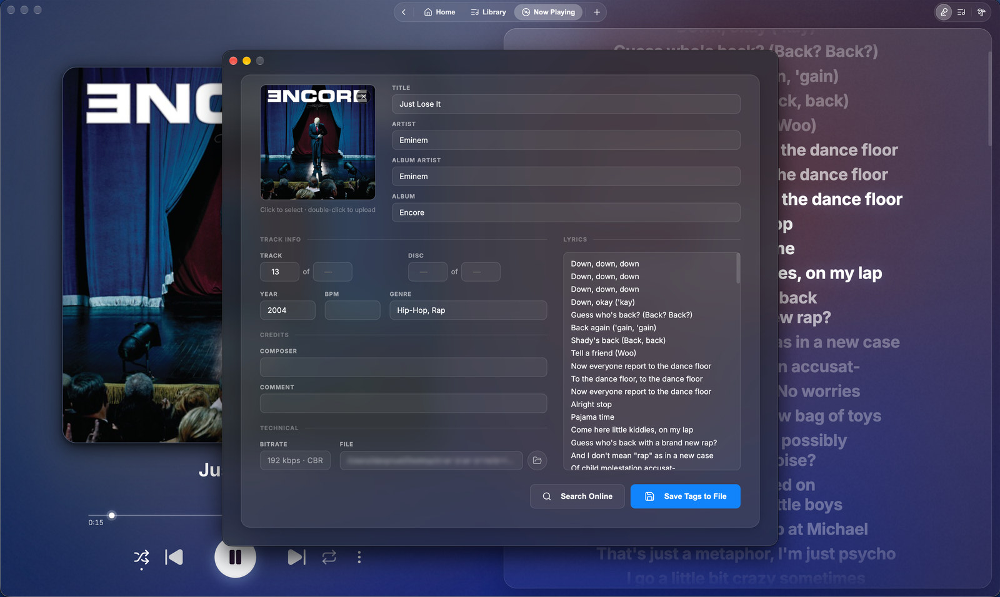

Hit **Search Online** and Sonus finds the right title, album, year, full-size cover and lyrics. Pick a match and you're done in two clicks.

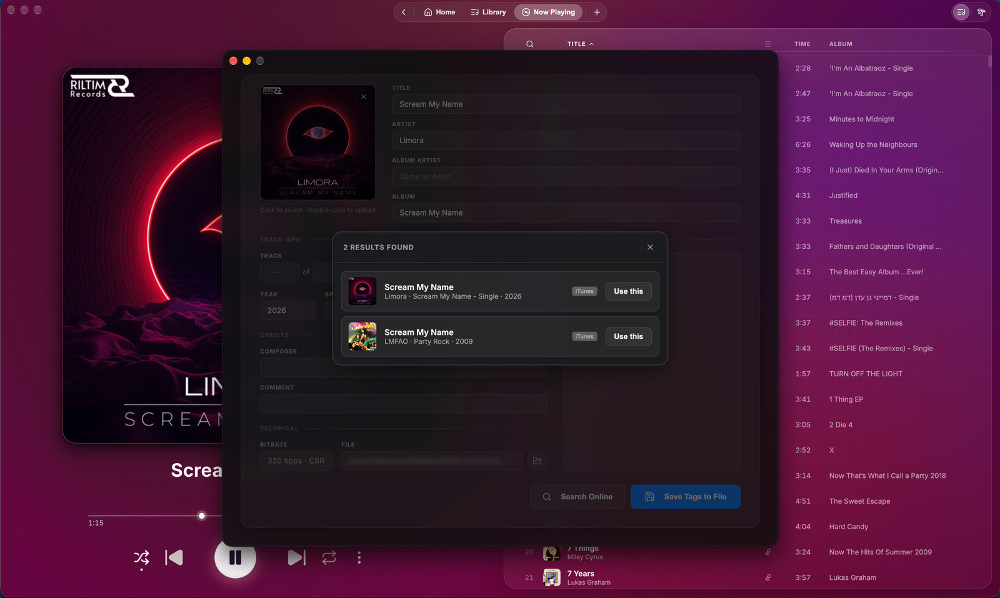

<details>
<summary><b>Which formats it can write</b></summary>

- **MP3**: ID3v2 tags
- **FLAC**: Vorbis comments
- **WAV**: an ID3 chunk inside the file

Covers (paste, drop a file, or find one online), lyrics, track and disc numbers, composer, BPM and more.

</details>

### Feels right at home on your Mac

- **Double-click any song** in Finder to play it in Sonus
- **Right-click songs or a whole folder** in Finder → *Sonus - Play*, *Play Next* or *Add to Queue*
- **Media keys** and Control Centre's Now Playing, with artwork
- **Close the window and the music keeps playing**, like any Mac music player (`⌘Q` to quit)
- **Drag and drop** files or folders, or press `⌘O`

<details>
<summary><b>Keyboard shortcuts</b></summary>

| | |
| --- | --- |
| **File** | Add Music `⌘O` · Filled Screen `⌃⌘M` · Narrow `⌥⌘2` · Mini `⌥⌘3` · Strip `⌥⌘4` · Chill `⇧⌘C` |
| **Controls** | Play/Pause `Space` · Next `⌥⌘→` · Previous `⌥⌘←` · Shuffle `⇧⌘S` · Repeat `⌥⌘R` · Go to Current Song `⌘L` |
| **Anywhere** | Search `⌘F` · Select all `⌘A` · Remove from list `⌫` · Seek ±5 s `←` `→` · Leave Mini, Strip or Chill `Esc` |

</details>

---

## Opening Sonus the first time

Sonus is free, so it isn't signed with a paid ($99/year) Apple certificate. The first time you open it, macOS warns you that it can't check the app. That's all it means. You only do this **once**:

**macOS 12, 13 and 14:** right-click **Sonus** in Applications → **Open** → **Open**.

**macOS 15 and newer:** try to open Sonus, then go to  → **System Settings** → **Privacy & Security**, scroll to Security, and click **Open Anyway**.

**Or in Terminal:**

```bash
xattr -dr com.apple.quarantine /Applications/Sonus.app
```

Every release lists **SHA-256 checksums** so you can check your download is exactly what was built:

```bash
shasum -a 256 ~/Downloads/Sonus-1.10.0-universal.dmg
```

> Prefer not to run unsigned apps? [Build it yourself](#building-from-source). It's four commands.

---

## Privacy

Your music, play counts and files stay on your Mac. No accounts, no analytics, no telemetry. Sonus makes **no network requests at all when it starts**, and works fully offline.

It only goes online when **you** click one of these:

| When you click | What it contacts | Why |
| --- | --- | --- |
| **Search Online** in the Tag Editor | iTunes Search API, MusicBrainz, Cover Art Archive, lrclib, lyrics.ovh | Find tags, covers and lyrics for the song you're editing |
| **Start Mix** on a song | MusicBrainz, ListenBrainz Labs, Deezer | Find similar songs in your library (free, no account) |
| **Search in YouTube** | Opens youtube.com in your browser | You asked it to |

That's the whole list.

---

## Requirements

| | |
| --- | --- |
| **macOS** | 12 Monterey or newer |
| **Mac** | Any Intel or Apple Silicon Mac (one universal app). 1.10 is the last version for Intel Macs |
| **Disk** | ~500MB |

## Building from source

```bash
git clone https://github.com/panawel/sonus-player.git
cd sonus-player
npm install
npm run dev
```

<details>
<summary><b>Building, testing and how it's made</b></summary>

Build a universal `.dmg` and `.zip` into `release/`:

```bash
npm run build
```

Checks:

```bash
npm test                     # unit tests
npm run lint
./scripts/verify-bundle.sh release/mac-universal/Sonus.app --expect-universal
```

There's also an end-to-end smoke suite that drives the **built** app (real Electron, real Chromium): the metadata pipeline, tag writing for all three formats, every window size, the menus, Chill mode's scenes, and a 20,000-song speed test.

```bash
npx vite build && npx electron . --smoke
```

While developing, run just the part you touched: `npx electron . --smoke --only=menus`. The full packaging walkthrough is in [`BUILD_INSTRUCTIONS.md`](BUILD_INSTRUCTIONS.md).

Sonus is an Electron app with a React 19 interface, with a strict wall between the two: the interface has no direct access to your system, and everything it can do is declared in one place. Curious how it's built? [`docs/ARCHITECTURE.md`](docs/ARCHITECTURE.md) is a deep dive.

</details>

## Built with

[Electron](https://electronjs.org) · [React](https://react.dev) · [Vite](https://vite.dev) · [music-metadata](https://github.com/borewit/music-metadata) · [node-id3](https://github.com/Zazama/node-id3) · [TanStack Virtual](https://tanstack.com/virtual) · [dnd kit](https://dndkit.com) · [Lucide](https://lucide.dev) icons

Online data from the [iTunes Search API](https://developer.apple.com/library/archive/documentation/AudioVideo/Conceptual/iTuneSearchAPI/), [MusicBrainz](https://musicbrainz.org), [Cover Art Archive](https://coverartarchive.org), [lrclib](https://lrclib.net), [lyrics.ovh](https://lyrics.ovh), [ListenBrainz](https://listenbrainz.org) and [Deezer](https://www.deezer.com).

## License

[MIT](LICENSE) © 2026 panawel
